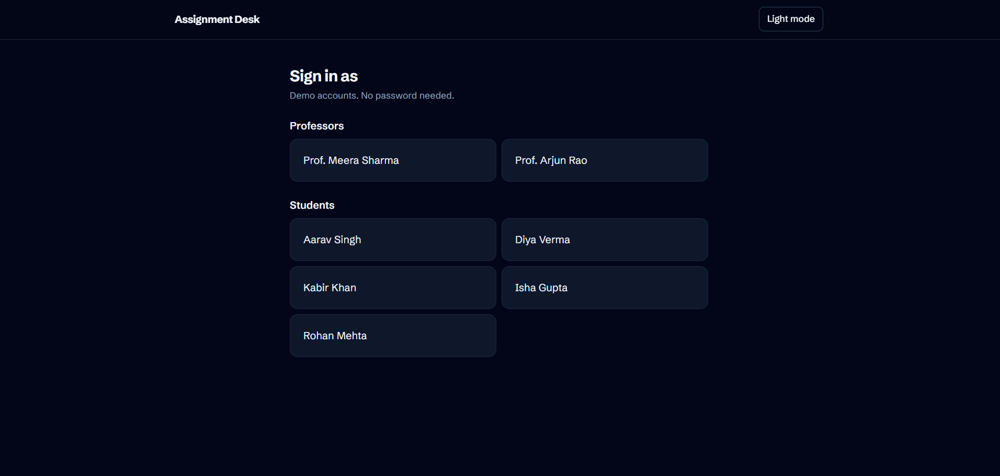

# Assignment & Review Dashboard

A role-based dashboard where professors post assignments for their courses and students acknowledge their submissions, individually or as a group. Built with React, Tailwind CSS and Vite. There is no real backend: a mock API backed by `localStorage` stands in for one, so data survives a refresh.

**Live demo:** https://student-assignment-dashboard-iota.vercel.app/



## Demo accounts

All demo accounts use the password `password123`.

| Role | Email |
| --- | --- |
| Professor | meera@college.edu, arjun@college.edu |
| Student | aarav@college.edu, diya@college.edu, kabir@college.edu, isha@college.edu, rohan@college.edu |

You can also register a new account and choose either role.

## What it does

**Authentication**
- Login and register forms with field-level validation and clear server errors
- The user picks Student or Professor when registering, and each role lands on its own dashboard
- The session is a JWT-shaped token stored in `localStorage` with a 2 hour expiry. Logging out clears it, protected routes redirect to `/login`, and a role cannot open the other role's pages

**Professor**
- Dashboard with a card for each course they teach (and a button to add a course)
- Assignments page: create, edit and view assignments with title, description, deadline (date and time), OneDrive link and submission type (Individual or Group)
- Per assignment: submitted count out of total (students or groups), a progress bar, and a drill-down of who has and hasn't submitted
- Search by title and filter by deadline status

**Student**
- Dashboard with cards for the courses they are enrolled in, each with a progress bar
- Assignments page showing description, deadline, OneDrive link, submission type and acknowledgement status
- Individual assignments: "Yes, I have submitted", then a confirmation dialog, and the timestamp is stored
- Group assignments: only the group leader can acknowledge, and every member then sees "Acknowledged by [Leader] on [date and time]"
- Students without a group see "You are not part of any group. Create or join one to submit this assignment." with a button to create or join one
- Create a group (you become the leader) or join an existing one, and see the members and the leader

**Polish**
- Progress bars, status badges and checkmarks, with overdue assignments highlighted
- Toast messages, hover states, small transitions, skeleton loaders, empty states and retryable error states
- Responsive from phone to desktop, dark mode, keyboard-friendly dialogs and labelled form fields

## Tech

React 18, React Router 6, Tailwind CSS v4, Vite. State is local component state plus two small contexts (auth and toasts).

## Run locally

```bash
npm install
npm run dev
```

## Structure

```
src/
  api/          mockApi.js (all endpoints, token handling, rules), seed.js
  components/   reusable UI: Modal, Field, Badge, ProgressBar, cards, forms, route guards
  context/      AuthContext, ToastContext
  hooks/        useAsync (loading / error / reload), useTheme
  pages/        Login, Register, Professor and Student dashboards and course pages
  utils/        dates.js, validate.js
```

## Notes on the mock API

- Every call waits about 300 ms and reads the stored database fresh, so loading states are real
- The rules live in the API, not the UI: students can only open courses they are enrolled in, only a group leader can acknowledge a group assignment, and the submission type cannot change once someone has acknowledged
- New students are enrolled in all courses of the semester, and a course created by a professor enrolls all students
- Passwords are lightly hashed and the token is not cryptographically signed. This is a mock, not real security
- To reset the demo data, clear `ard.db` and `ard.token` in DevTools > Application > Local Storage
